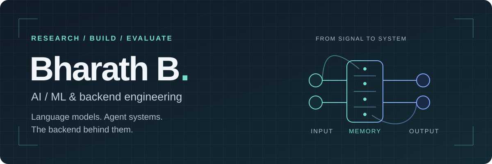
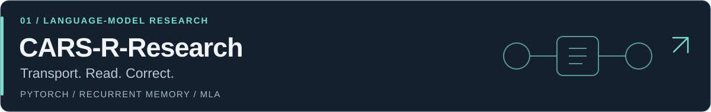
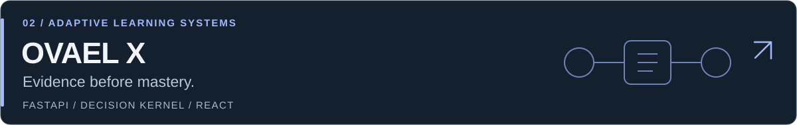
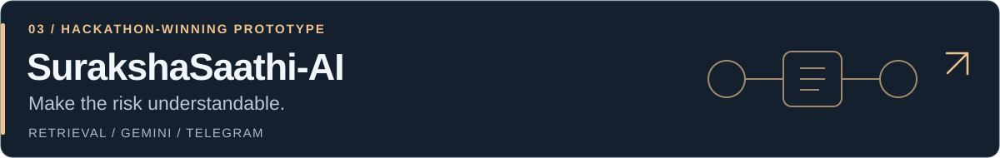

  

  <a href="https://bharat122551b.vercel.app/">Portfolio</a> &nbsp; / &nbsp;
  <a href="https://www.linkedin.com/in/bharath-b-7894b5382/">LinkedIn</a> &nbsp; / &nbsp;
  <a href="mailto:bharath122551b@gmail.com">Email</a>

### Hi, I'm Bharath.

I'm an Information Technology student at **ABV-IIITM Gwalior**, working across core ML, language-model research, shared memory, agents, and backend systems. I'm currently a **Software Development Engineer & ML Intern at Sangillence**.

I like taking an idea through the whole engineering loop: build the architecture, inspect its behavior, measure it against a baseline, and keep the limitations visible.

---

## Selected work

Three recurrent CARS blocks with a causal MLA anchor. Built around Cayley transport, read-before-write memory, and ridge corrections, with a mathematical reference, a qualified faster execution path, and matched baselines.

**Measured:** 3.78× faster logged training-step time than the original CARS operator at 1,000 steps, seed 1337. Single-object ownership accuracy stayed at 100%; two-object tests remained at 0%. This is a local comparison, not an overall language-model performance win.

[Explore the research →](https://github.com/Bharath122babu/CARS-R-Research)

A deterministic decision kernel controls the next learning step; AI handles bounded explanation and ambiguous semantic work. Typed assessment, source retrieval, learner memory, and proof-of-learning signals share one pipeline. Unverifiable answers abstain instead of earning mastery credit.

**Engineering focus:** backend decisions, evidence contracts, and AI-call control. The kernel makes zero model calls; a learning turn shares a budget of up to three semantic calls. **144 backend tests, 7 frontend contract tests, and a passing production build.** Learning-outcome and cost advantages over other tools are not yet measured.

[Explore the workbench →](https://github.com/Bharath122babu/ovael-x)

A Telegram-first assistant for reviewing suspicious messages in English, Hindi, or Hinglish. Retrieval and Gemini analysis produce risk explanations and suggested safe next steps; Gmail monitoring sends Telegram alerts. I led the team and built the backend in roughly 16 hours.

**Winner — AI Synergy Hackathon, Gwalior AI Summit, March 2026.** A safety prototype, not a guarantee that a message is safe.

[Explore the project →](https://github.com/Bharath122babu/surakshasaathi-ai)

---

## Tools I work with

| Area | Tools & concepts |
| :--- | :--- |
| ML & research | Python · PyTorch · language models · recurrent memory · model evaluation |
| Backend & data | FastAPI · Pydantic · SQLite · Node.js · Firebase · PostgreSQL |
| Agents & retrieval | bounded orchestration · RAG · local model routing · MCP |
| Interfaces | TypeScript · React · Vite · Three.js · AR.js · A-Frame |
| Engineering workflow | Git · GitHub Actions · pytest · reproducible experiments |

## What I'm exploring

- **Efficient language models:** how memory, state updates, and attention change learning and inference.
- **Inspectable AI systems:** explicit decisions, bounded model calls, and useful failure recovery.
- **Evidence-based learning:** learner progress that comes from verified assessment rather than fluent answers.

Alongside the public work, I'm developing **SOVEREIGN**, a local-first agentic workbench for confidential workflows. Source is not publicly released.

## Let's build something useful.

Open to conversations about ML research, agent systems, and backend engineering.

**[LinkedIn](https://www.linkedin.com/in/bharath-b-7894b5382/)** · **[Portfolio](https://bharat122551b.vercel.app/)** · **[bharath122551b@gmail.com](mailto:bharath122551b@gmail.com)**

Models worth studying. Systems worth using.

